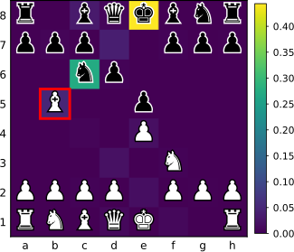

What does a neural network actually learn when it learns to play chess?

Does it develop concepts humans would recognize, like forks or pins? Or does it arrive at strong play through representations that look very different from our own? 

In this mini-series, I train a transformer to predict the next move in real chess games, then reverse engineer it to see what it learned.

<figure class="image-with-caption" style="--image-caption-width: 480px;">
  
  <figcaption class="image-caption">A peek inside: In a Ruy Lopez position, one attention head focuses the bishop along its pinning diagonal.</figcaption>
</figure>

The model is not explicitly taught tactics, strategy, or even how the pieces move. It only sees board positions and the moves strong players chose next. And yet, if it learns to play the game well, something inside the network must be encoding the abstractions needed to understand it.

This first post covers the design decisions, training process, and initial evaluation of the model.

## Architecture
While the strongest chess engines currently use a combination of tree search with neural network evaluations, the transformer is a much more natural fit for interpretability work. The board has 64 squares, so we can represent a position as a fixed-length sequence where each token corresponds to a physical square. Each position in the residual stream thus represents the same square throughout the network, while attention patterns map directly to interactions between squares.

My core model is a small transformer with bidirectional attention: 8 layers, 8 heads, d<sub>model</sub> = 256, d<sub>ffn</sub> = 1024, and ~6.5 million parameters. While [Leela](https://arxiv.org/abs/2409.12272) (the SoTA chess transformer) uses post-norm with scaling, I used pre-norm to preserve a cleaner additive residual stream, which makes attention-head and MLP contributions easier to isolate. Leela also uses a much smaller FFN-to-d<sub>model</sub> ratio than is standard, but I kept mine at the conventional 4x. In general, I avoided most domain-specific tricks or inductive biases and focused on keeping the architecture interpretable.

## Tokenization
Each board position is converted to a 68-token sequence: 64 square tokens (empty, or one of 12 piece/color combinations), plus a few auxiliary tokens for castling rights, en passant, and the halfmove clock. 

Some prior work instead feeds move history into a language model and has it predict the next move as text. In that setting the model must first reconstruct the board state internally before it can reason about it, and [Adam Karvonen's work on chess world models](https://adamkarvonen.github.io/machine_learning/2024/01/03/chess-world-models.html) showed that transformers actually learn to do this. I instead tokenize the board directly, since chess evaluation depends primarily on the current game state rather than the move history that produced it. This lets the model spend its capacity reasoning about positions rather than reconstructing them.

I also canonicalize every position to “white to move” by mirroring black-to-play positions. This halves the effective state space and avoids learning mirrored versions of the same pattern. 

## Policy Head
The model predicts a move by decomposing it into a source square and a target square. Two MLPs operate on the final residual stream – one projects each square's embedding into a "source" representation, the other into a "target" representation. Their dot product gives a 64×64 matrix where entry (i, j) is the logit for moving the piece on square i to square j. Pawn promotions require an additional piece prediction, which is handled by a small classifier on the source representation.

The two MLPs share their first layer, based on the intuition that features useful for identifying source squares are likely also useful for identifying targets. The overall structure follows [Leela's policy head](https://arxiv.org/abs/2409.12272).

## Data
I pulled 50,000 games from the [Lichess Open Database](https://database.lichess.org/), filtered to games where both players were rated 1800+ and the time control gave each player at least three minutes. The filters keep the dataset focused on strong, deliberate play.

That gave me ~3.75M board positions (≈75 plies per game), split 3.5M train / 0.25M validation.

## Training

The model is trained to predict the move the human played. Training on Stockfish evaluations would yield a stronger model, but maximal playing strength isn't the goal here so strong human moves suffice.

The loss is a 4096-way cross-entropy over all (from, to) square pairs. I intentionally avoid masking illegal moves at training time so that legal piece movement is learned and represented somewhere in the weights.

I trained for ~14M positions total, roughly four epochs over the training set. Thanks to a relatively small architecture and an optimized training pipeline, validation loss plateaued after only about an hour of training on a single L4 GPU.

## Initial Evaluation

In evaluation games against a Stockfish engine set to 1450 Elo, it scored approximately 50% over a 100-game match. This rating should be interpreted loosely since Stockfish’s weakened play is not very human-like.

On 20,000 held-out validation positions:

- **Legality:** The model outputs a legal move 99.8% of the time, meaning it has internalized the rules without being told them explicitly.
- **Accuracy:** Model predicts the human move 49% of the time. The human move is in the model's top three choices 77.6% of the time and in the top five 87.7% of the time.

The below game is illustrative of the model's style. It plays principled, aggressive chess and occasionally finds nontrivial ideas against an opponent whose play, quite fittingly, resembles a bot’s:

```pgn
[Date "2026.05.08"]
[Round "?"]
[White "Chess Transformer"]
[Black "Crappy Stockfish"]
[Result "1-0"]

1. e4 Nc6 2. d4 e5 3. d5 Nb4 4. a3 Na6 5. c4 Nb8 6. Nc3 h6 7. f4 exf4 8. Bxf4 Bc5 9. Nf3 d6 10. Bd3 Bg4 11. b4 Bd4 12. Rc1 Nf6 13. h3 Bxf3 14. Qxf3 a5 15. Nb5 Bb2 16. Rc2 Bxa3 17. Nxa3 g5 18. Bh2 g4 19. hxg4 Rg8 20. O-O h5 21. Qxf6 Qxf6 22. Rxf6 axb4 23. Nb5 Nd7 24. Nxc7+ Kd8 25. Nxa8 Nxf6 26. Bxd6 b3 27. Rb2 Kd7 28. Be5 Nxg4 29. Nb6+ Ke7 30. Bd4 Re8 31. Rxb3 Rd8 32. c5 f6 33. c6 Kf7 34. c7 Rd6 35. c8=Q h4 36. Qxb7+ Kf8 37. Bc5 f5 38. Bxd6+ Kg8 39. exf5 Nf6 40. Qc8+ Kh7 41. Qc7+ Kh8 42. Be5 Kg8 43. Bxf6 Kf8 44. Qe7+ Kg8 45. Qg7# 1-0
```

A small but telling example of sequential planning starts after [27... Kd7](#ply-54) as both white's bishop and knight are under attack. There model manages to save both, starting with [28. Be5](#ply-55), saving the bishop while attacking Black's knight (so Rxa8 would be met with Bxf6). After [28... Nxg4](#ply-56), both pieces are under attack again, so the model continues with [29. Nb6+](#ply-57), escaping with check to evacuate the bishop the next move.
{: .chess-viewer-caption}

I also tested the model against myself and my friends, and observed that its opening repertoire and positional play are noticeably stronger than those of a typical human at this playing level. At the same time, it's tactically fragile and prone to simple blunders. It also struggles to convert winning positions, likely because strong human games often end in resignation before checkmate appears on the board. I hypothesize that these weaknesses reflect the training distribution of precise, positional games, and would be reduced by augmenting the data with puzzles and mating positions.

The model’s uneven capabilities actually make it especially interesting for interpretability work. It is strong enough to learn meaningful chess concepts, yet weak enough that its failures remain visible. Rather than treating these weaknesses as noise, they may expose where the model’s internal representations diverge from robust chess understanding.

## What's Next

I've posted the full codebase and implementation details on [Github](https://github.com/aaravd18/transformer-chess). Following from the preview at the top, the next post uses some classic mechanistic interpretability techniques to open the model up and explore its internal representations of the game.
