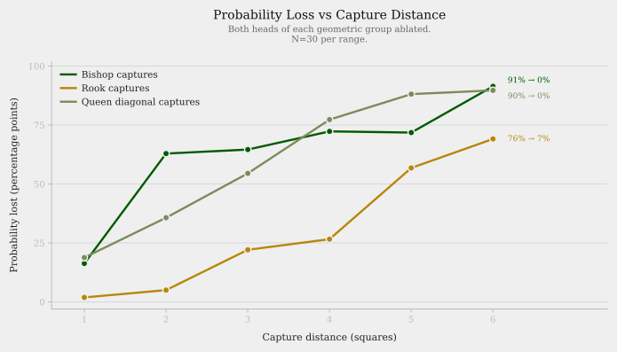
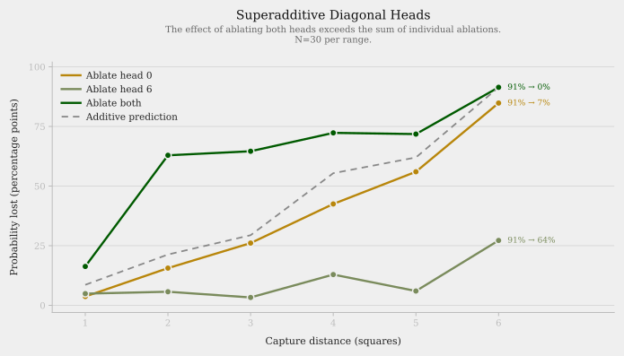

In my [previous post](/posts/transformer-chess-2), I trained a small transformer to play chess. In this post I take the model apart.

## Attention

The first intuitive step to interpreting a transformer is taking a look at the attention maps. Here are the eight heads from layer 0:

The heads in layer 0 specialize by movement geometry. Two attend along diagonals, two along knight jumps, one along ranks, one along files. The remaining two look like king and pawn movement.

A chess model learning chess geometry is nice, but not that surprising. The patterns are visible, but visible patterns don't tell us what the heads actually *do*. For that I need to break them.

## Mean Ablation

To test whether each head is functionally responsible for its geometry, I ran mean ablation. For each head I computed its average activation over 1000 random positions, then patched that average into the forward pass on a test position. This removes the head's contribution while keeping the model on-distribution.

On the position above, ablating head 0 — the primary diagonal head — destroys the model's ability to find the long-range bishop capture, but makes it *more* confident in the winning knight capture. Ablating head 2, a knight-jump head, does the reverse. The specialization is functional, not just visual: capabilities can be surgically disabled.

To check this isn't a one-position fluke, I ran the same ablations across a set of Stockfish-evaluated positions where a single capture was the clear best move (at least 100cp better than the next best). Most geometries are covered by more than one head — two diagonal, two knight-jump, one rank, one file, plus the king-ish and pawn-ish heads — so I ablated each geometric group together rather than one head at a time.

Each capture type collapses only under ablation of the matching head group. The off-diagonal effects are small (mostly within a few percent), which is what you'd want to see if the heads really are independently responsible for their geometries.

## Specialization scales with distance

The first cross-ablation results had a wrinkle I didn't expect. The mean ΔP for diagonal and rook ablations on their matching capture types wasn't as extreme as the knight result. Ablating the diagonal heads didn't reliably destroy bishop captures — it depended heavily on the position.

The pattern turned out to be distance. Short captures survive, long captures don't:

For a 1-square bishop capture, ablating both diagonal heads costs about 16% probability. For a 6-square capture, it costs 91%. Rooks show the same shape on rank+file ablation; queen diagonal captures show the same shape on diagonal ablation, slightly steeper than bishops.

The interpretation I'd offer: short-range moves are redundantly encoded across multiple channels — adjacent squares get talked about by lots of heads for lots of reasons, so removing the dedicated geometric head leaves plenty of backup. Long-range moves don't have that redundancy. A bishop seeing 6 squares down a diagonal is doing something only the diagonal head does, and removing it leaves nothing.

So "specialization" isn't quite the right word on its own. The heads are specialized *for the cases that need them* — long-range geometric reasoning — and shared with the rest of the model for the easy cases. The cleanest framing I have: these aren't single-purpose heads, they're load-bearing for capabilities that nothing else can carry.

## Superadditivity

The diagonal capability turns out to be split across two heads, not concentrated in one. Ablating head 0 alone drops long-range bishop captures sharply; ablating head 6 alone is much milder; ablating both is more than the sum:

The capability lives in a small circuit, not a single head.

## Caveats

Mean ablation measures necessity, not sufficiency. A head being required for long-range bishop captures doesn't mean that head alone implements them — the downstream layers that consume its output are doing real work too. All I can say from these experiments is which components, when removed, break which capabilities. That's a useful but limited claim.

## What's next

[bridge to next post — pin geometry analysis on the Ruy Lopez position now that we know what the diagonal head is responsible for. Or whatever comes next.]