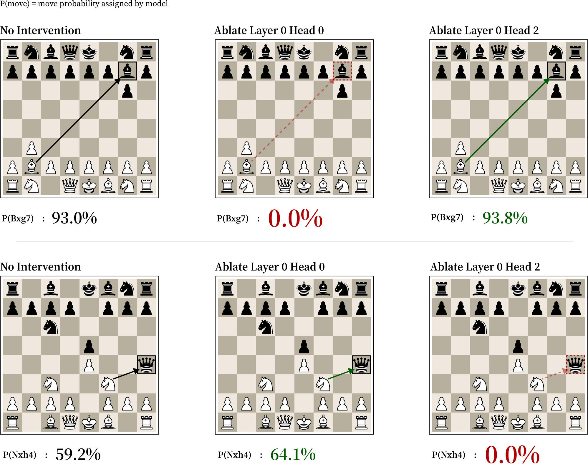
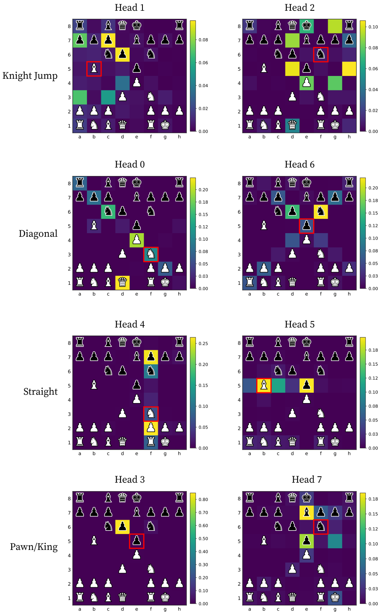
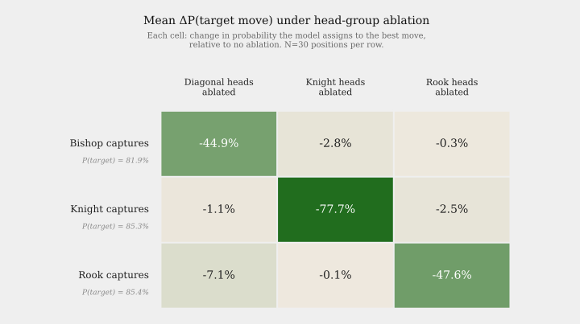

In my [previous post](/posts/transformer-chess), I trained a small transformer to play chess. Now, I reverse engineer what it learned.

The central finding of this post is that we can selectively disable certain capabilities of the model by ablating individual attention heads. This effect scales with move distance, meaning the model has substantial redundancy for short-range geometry but relies increasingly on specialized heads at long ranges. 

<figure class="image-with-caption wide-image" style="--image-caption-width: 900px; margin-bottom: 3.5rem; margin-top: 3rem; --image-caption-gap: 2.5rem;">
  
  <figcaption class="image-caption">Ablating a single attention head destroys the model's ability to find the long-range bishop capture, but makes it more confident in the winning knight capture. Ablating a different head does the reverse.</figcaption>
</figure>

We'll soon examine this result more rigorously. But first, let's start from the&nbsp;beginning.

## Attention Maps

A natural first step in interpreting our transformer is to examine the attention heads. In the first layer, the model appears to have learned the distinct geometric patterns of chess:

At face value, this suggests a clean geometric division of labor inside the layer. Two heads attend along diagonals, two along knight jumps, one along ranks, one along files. The remaining two look like king and pawn movement. But attention maps alone don't tell us whether the heads are actually responsible for those computations.

## Mean Ablation

To test whether each head is functionally responsible for its geometry, I ran mean ablation.[^1] For each head I computed its average activation over 1000 random positions, then patched that average into the forward pass on a test position. This removes the head's contribution while keeping the model on-distribution, and is how we obtained the result in the first headline figure. 

To check that wasn't a one-position fluke, I ran the ablations across a set of Stockfish-evaluated positions where a single capture was the clear best move (at least 100cp better than the next best). Since most geometries are represented by multiple heads, I ablated each geometric group together rather than one head at a time.

Each capture type collapses only under ablation of the matching head group, and the off-diagonal effects are small. This confirms the head specialization.

## Specialization Scales With Distance

It seemed peculiar that the mean ΔP for diagonal and rook ablations on their matching capture types wasn't nearly as extreme as the knight result. 

Inspecting the positions individually revealed that the effect for diagonal and rook captures was highly non-uniform. Some captures had their probability almost completely destroyed by ablation, while others were barely affected.

The pattern turned out to be distance.

For a 1-square diagonal capture with either bishop or queen, ablating both diagonal heads costs about 17% probability. For a 6-square capture, probability is completely destroyed on all 30 bishop positions, and all 30 queen positions. Rooks show the same shape on rank+file ablation, with a slightly lower effect size at each distance.

The pattern suggests that the model represents local geometry redundantly, but long-range geometry sparsely.[^2]

A chess position is primarily built on short range relationships. Lots of heads have reasons to represent nearby squares, so removing the dedicated geometric heads still leaves backup paths through the network. On the other hand, a bishop seeing six squares down a diagonal is a comparatively specific operation, and the model seems to rely on a much smaller set of components to do it.

So, the "bishop" or "rook" heads are not equally important across all examples of their geometry. Rather, their influence emerges as the nature of the position becomes increasingly long-range. 

## Superadditivity

The last piece of the story is about how heads in the same circuit interact.

Ablating head 0 alone significantly reduces bishop captures, and ablating head 6 alone is much weaker. But together, they're superadditive: the effect of ablating both heads exceeds the sum of the individual head ablations.

Interestingly, the superadditive effect is strongest at low-to-medium distances. This suggests shorter-range diagonal geometry is supported by a multi-head circuit, while the longest-range captures depend more heavily on one dominant component.

## What this might mean

This result makes me think about how language models handle long context.

Even though a transformer can attend globally, it may learn to rely heavily on nearby tokens, since they provide the most relevant context. However, if the answer depends on a detail introduced much earlier, the model has to carry that specific information forward and use it at the right moment. 

That is the parallel to the chess result. Nearby geometry was easy for the model to recover from multiple places, but long ranges were much less forgiving. Maybe language models have a similar split between predictions supported by local context and predictions that require preserving a specific dependency over distance.

I don't think this toy model demonstrates that. But it does make me suspect that the most interesting circuits in transformers may only reveal themselves once the task becomes sufficiently specific.

[^1]: Mean ablation tests necessity, not sufficiency. A head being required for some capability doesn't mean that head alone implements it.
[^2]: One caveat is that mean ablation is not a neutral removal. Since the patched activation reflects typical behavior, it may preserve common short-range structure better than rare long-range structure. 

